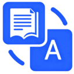
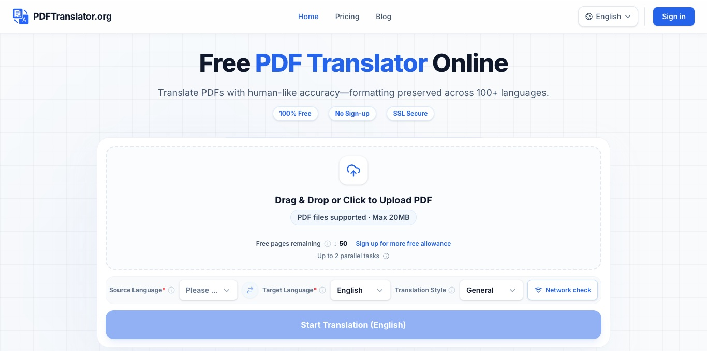
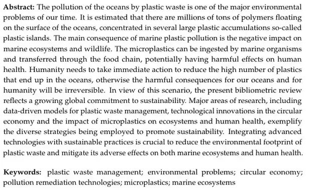
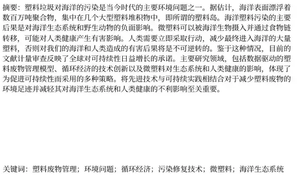
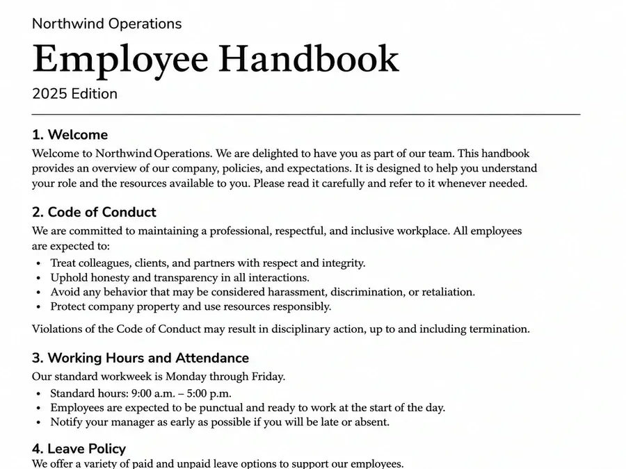
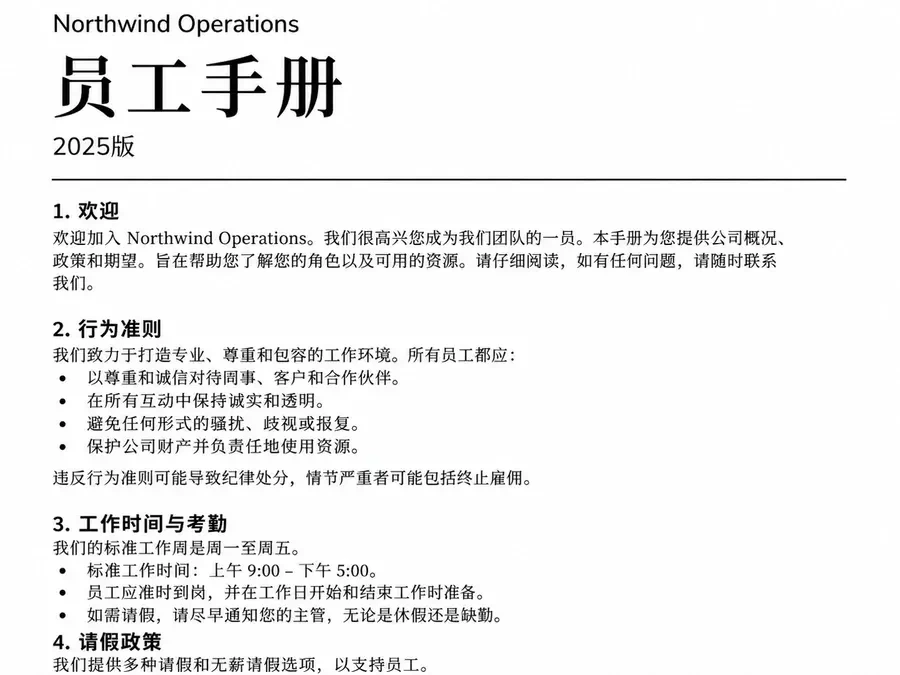
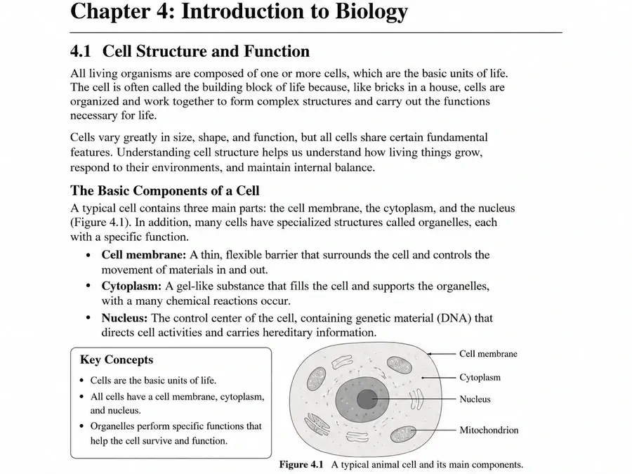
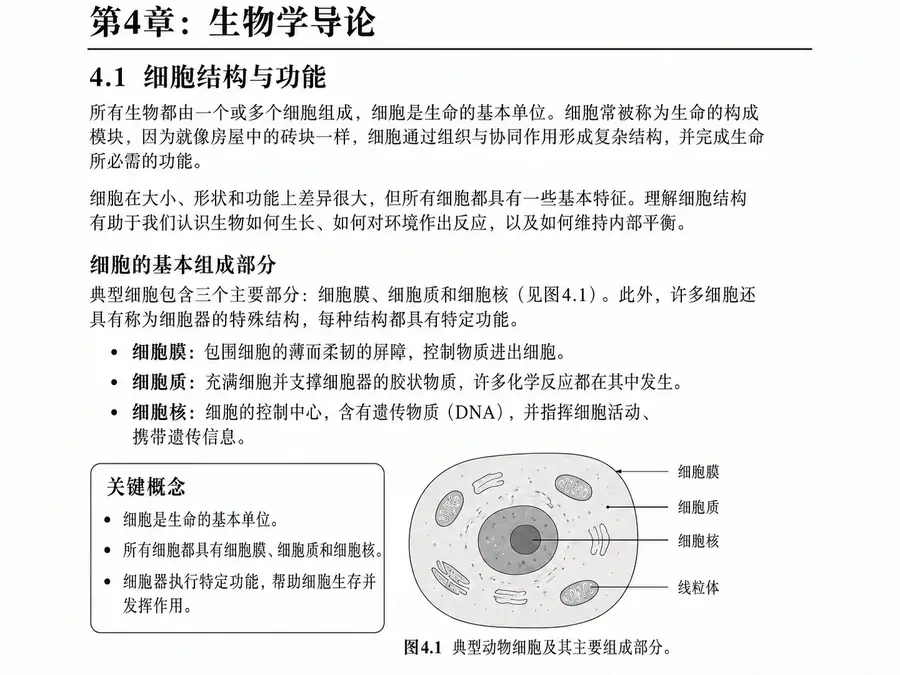
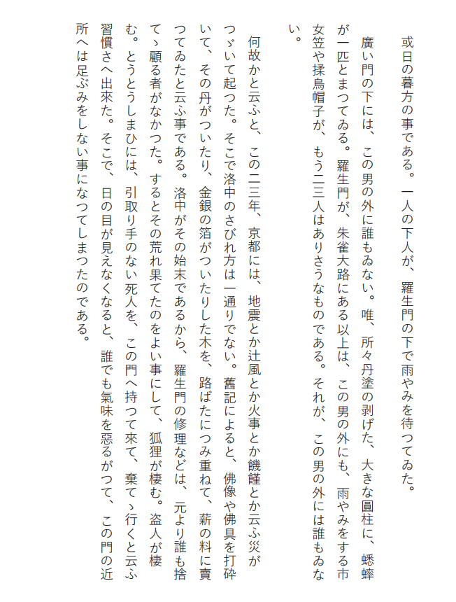
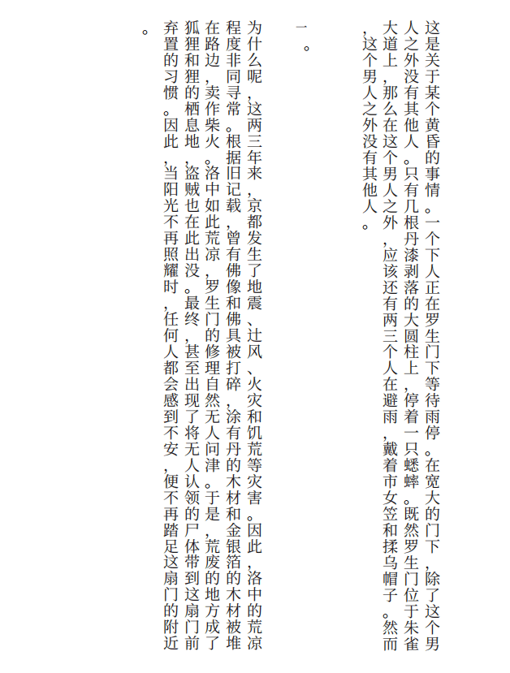

[English](README.md) · [简体中文](README.zh-CN.md) · [Español](README.es.md) · [Português (Brasil)](README.pt-BR.md)

# PDFTranslator.org — Traductor de PDF online gratis con IA

[PDFTranslator.org](https://pdftranslator.org/es) traduce documentos PDF a más de 100 idiomas y procura conservar la disposición del texto, las tablas y las imágenes. Puedes descargar solo la traducción o un PDF bilingüe para compararla con el original.

**Sin cuenta tienes 50 páginas gratuitas de PDF ordinarios por mes natural. Una cuenta gratuita incluye 600 al mes y un regalo único de 1.000 créditos al registrarte. Si un escaneo necesita OCR, se cobran créditos por todo el archivo.**

[Traducir un PDF online](https://pdftranslator.org/es) · [Planes y precios](https://pdftranslator.org/es/pricing) · [Comentarios y sugerencias](https://pdftranslator-org.feedlog.ai/)

Este es el repositorio oficial de documentación del producto, mantenido por [SaaSAIHub](https://github.com/SaaSAIHub). Incluye guías y ejemplos del servicio web; no contiene el código fuente de la aplicación ni el motor de traducción.

*Vista de visitante en la página de inicio en inglés.*

## Traducción de PDF con IA: funciones y límites

PDFTranslator ayuda a estudiantes, investigadores y profesionales a leer documentos en otros idiomas sin copiar y pegar cada párrafo en un traductor de texto.

| Función | Comportamiento actual |
| --- | --- |
| Descargas en PDF | PDF con la traducción o PDF bilingüe con el original y la traducción. |
| Más de 100 idiomas | Selecciona los idiomas de origen y destino. |
| Conservación del formato | Intenta mantener la disposición, las tablas, las imágenes y la estructura; revisa los documentos complejos. |
| Estilos de traducción | General, Académico, Legal o Empresarial. |

| Tipo de acceso | Páginas ordinarias gratuitas al mes | Máximo por archivo | Tareas en cola y en curso en total |
| --- | ---: | --- | ---: |
| Visitante | 50 | 20 MiB / 200 páginas | 2 |
| Cuenta gratuita | 600 | 20 MiB / 200 páginas | 2 |
| Pase mensual activo | 600 | 50 MiB / 800 páginas | 5 |

El pase mensual se paga una sola vez y dura 30 días. Las tareas nuevas tienen prioridad mientras esté activo. No se renueva automáticamente.

## Cómo traducir un PDF online

1. Abre [PDFTranslator.org](https://pdftranslator.org/es) y selecciona o arrastra tu PDF.
2. Elige el idioma original del documento y el idioma de destino.
3. Selecciona el estilo General o uno especializado: Académico, Legal o Empresarial.
4. Inicia la traducción y mantén la página abierta durante la carga y la revisión del archivo. Si bastan las páginas gratuitas y se cumplen los límites, la tarea pasa directamente a la cola. Si necesitas créditos, revisa el coste y confirma.
5. Consulta el progreso en las traducciones recientes de la página principal.
6. Previsualiza el resultado o descarga la traducción sola o en PDF bilingüe.

Conserva el original y descarga el resultado cuanto antes. La [guía de uso, en inglés](docs/usage-guide.md), explica la preparación de archivos, los límites y la resolución de problemas.

## Ejemplos de traducción de PDF

Estos pares de páginas proceden de los ejemplos publicados en el sitio. Los tres primeros muestran traducciones del inglés al chino. El cuarto muestra una página japonesa de escritura vertical traducida al chino.

### Traducción de artículos de investigación

Lee el resumen de un artículo en otro idioma manteniendo el contexto de los párrafos y las palabras clave.

<table>
<tr><th>Original en inglés: resumen y palabras clave</th><th>Traducción al chino: resumen y palabras clave</th></tr>
<tr><td width="50%"></td><td width="50%"></td></tr>
</table>

### Traducir manuales y guías en PDF

Consulta juntos los títulos de sección, las instrucciones numeradas y las listas de un manual.

<table>
<tr><th>Original en inglés: manual</th><th>Traducción al chino: manual</th></tr>
<tr><td width="50%"></td><td width="50%"></td></tr>
</table>

### Traducir libros de texto y material de estudio en PDF

Compara explicaciones, listas e ilustraciones al estudiar una página traducida.

<table>
<tr><th>Original en inglés: libro de texto</th><th>Traducción al chino: libro de texto</th></tr>
<tr><td width="50%"></td><td width="50%"></td></tr>
</table>

### Traducción de texto japonés vertical

Sigue las columnas de derecha a izquierda y comprueba la posición de los diálogos y los signos de puntuación.

<table>
<tr><th>Original en japonés</th><th>Traducción al chino</th></tr>
<tr><td width="50%"></td><td width="50%"></td></tr>
</table>

Para comprobar terminología, tablas, figuras y orden de lectura, consulta la [lista de revisión de traducción y formato, en inglés](docs/translation-review.md).

## Idiomas compatibles y usos de la traducción de PDF

PDFTranslator.org admite más de 100 idiomas de traducción, entre ellos inglés, chino, español, francés, alemán, portugués, japonés y coreano. El idioma de la interfaz y los idiomas del documento se eligen por separado.

| Objetivo | Selección de idiomas |
| --- | --- |
| Traducir PDF de inglés a español | Inglés como origen y español como destino. |
| Traducir un documento PDF a inglés | El idioma real del documento como origen e inglés como destino. |
| Traducir PDF a alemán | El idioma original y alemán como destino. |
| Traducir un PDF de inglés a chino o portugués | Inglés como origen y la opción de destino correspondiente. |

Elige Académico para artículos y materiales de estudio; Empresarial para informes y documentos de negocios; y General para lecturas cotidianas y manuales. El estilo Legal está disponible para terminología jurídica; revisa cualquier redacción de la que dependan decisiones importantes.

Interfaces del sitio: [English](https://pdftranslator.org/) · [中文](https://pdftranslator.org/zh) · [Español](https://pdftranslator.org/es) · [Português (Brasil)](https://pdftranslator.org/pt-BR).

## Preguntas frecuentes sobre la traducción de PDF

### ¿PDFTranslator.org permite traducir PDF gratis y sin registro?

Sí. Sin cuenta puedes traducir gratis 50 páginas de PDF ordinarios por mes natural. Con una cuenta, se usan primero las 600 páginas gratuitas del mes y cada página adicional cuesta 10 créditos. Las páginas gratuitas no se acumulan.

### ¿Puedo traducir un PDF sin perder el formato?

El servicio intenta conservar la disposición, las tablas, las imágenes y la estructura de las páginas. La traducción puede ocupar más o menos espacio. Revisa tablas complejas, fórmulas, fuentes y saltos de página; no se garantiza una reproducción exacta.

### ¿Puedo traducir documentos PDF largos?

Los visitantes y las cuentas gratuitas pueden subir hasta 200 páginas y 20 MiB por archivo. Con un pase mensual activo, los límites suben a 800 páginas y 50 MiB. Puedes dividir el PDF para traducir solo algunos capítulos.

### ¿Puedo traducir un PDF escaneado?

Sube el PDF escaneado. Si la revisión indica que necesita reconocimiento de texto (OCR), inicia sesión y revisa el coste. Se cobran 20 créditos por cada página del archivo, aunque solo algunas necesiten OCR. Puedes usar los créditos de bienvenida. Las páginas gratuitas no cubren el OCR.

### ¿El resultado es un documento de Word?

El flujo principal recibe PDF y devuelve PDF traducidos. Este repositorio no describe un conversor de PDF a Word ni promete archivos DOCX editables.

### ¿Durante cuánto tiempo puedo descargar la traducción?

El historial permanece visible durante 24 horas desde que la tarea termina, falla o se cancela. Si termina correctamente, tienes 24 horas para consultar y descargar el resultado, incluso con un pase mensual. Comprueba el vencimiento que figura en la tarea.

### ¿Los archivos se procesan solo en mi dispositivo?

El documento se sube al servidor para traducirlo. El historial del visitante se guarda en su navegador y el servicio gestiona el historial de las cuentas. Las copias almacenadas y los registros necesarios pueden conservarse después de que caduque el acceso. Consulta la [guía de privacidad, en inglés](docs/privacy.md).

### ¿Qué pasa si una tarea falla o la cancelo?

Puedes cancelar una tarea en cola hasta que comience el procesamiento. Si falla o se cancela correctamente, se devuelven las páginas y los créditos utilizados. Las páginas gratuitas se abonan al mes de origen.

### ¿Es un traductor de código abierto o un paquete de API pública?

Este repositorio contiene documentación oficial del sitio PDFTranslator.org. No incluye una aplicación autoalojable, un motor de traducción ni un paquete de API pública.

## Guías, herramientas PDF y comentarios

- [Uso y resolución de problemas al traducir PDF — inglés](docs/usage-guide.md)
- [Revisión de calidad y formato — inglés](docs/translation-review.md)
- [Carga de archivos, conservación y privacidad — inglés](docs/privacy.md)
- [Dividir PDF](https://pdftranslator.org/tools/split-pdf) · [Unir PDF](https://pdftranslator.org/tools/merge-pdf) · [Más herramientas PDF](https://pdftranslator.org/tools)
- [Comunicar un problema o sugerir una función en FeedLog](https://pdftranslator-org.feedlog.ai/)
- [Contribuir a la documentación — inglés](CONTRIBUTING.md)

Utiliza ejemplos sin información sensible en los comentarios públicos. No publiques documentos privados, identificadores de tareas ni enlaces firmados de carga o descarga.

**Información del producto verificada el 2 de noviembre de 2026.** Las funciones y los límites pueden cambiar; consulta el [sitio oficial](https://pdftranslator.org/es), la [política de privacidad](https://pdftranslator.org/privacy-policy) y los [términos del servicio](https://pdftranslator.org/terms-of-service).
