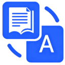
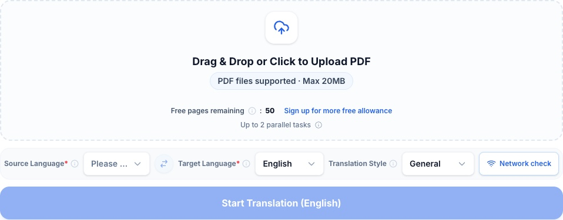
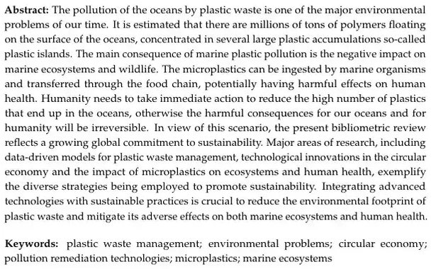
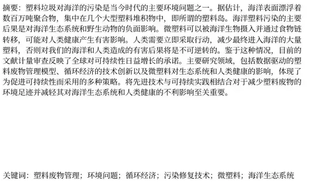
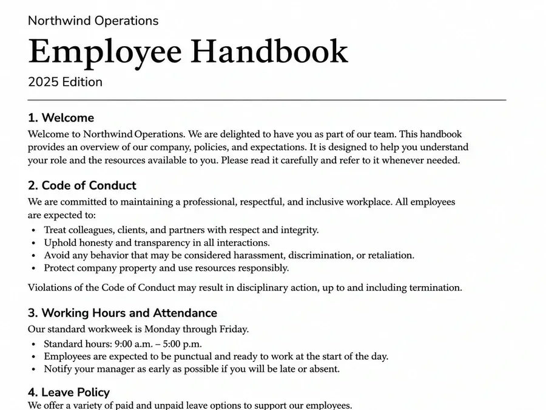
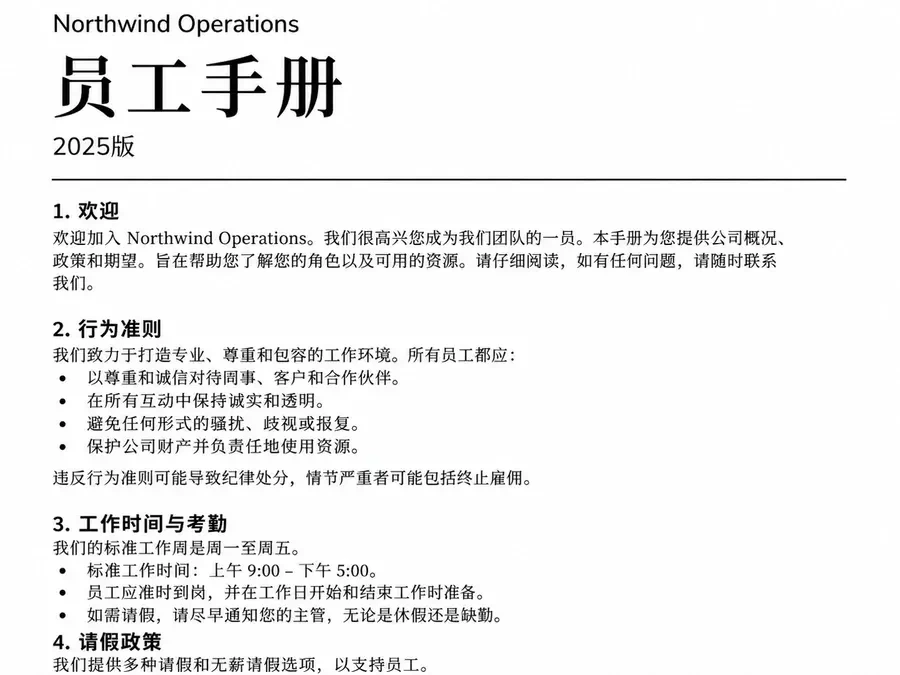
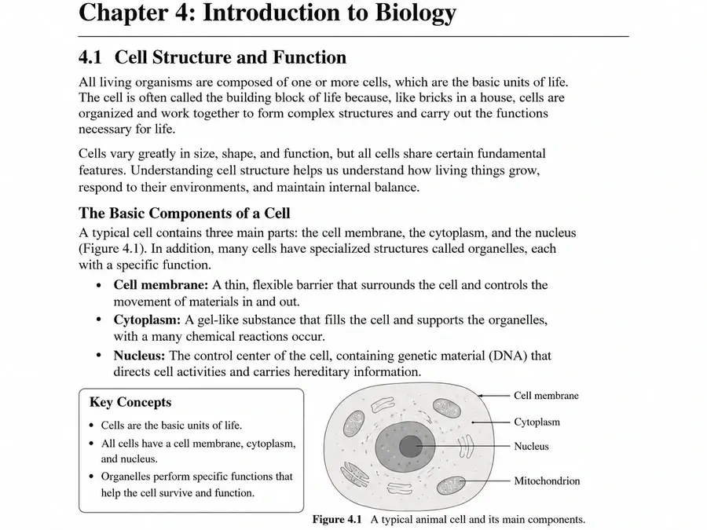
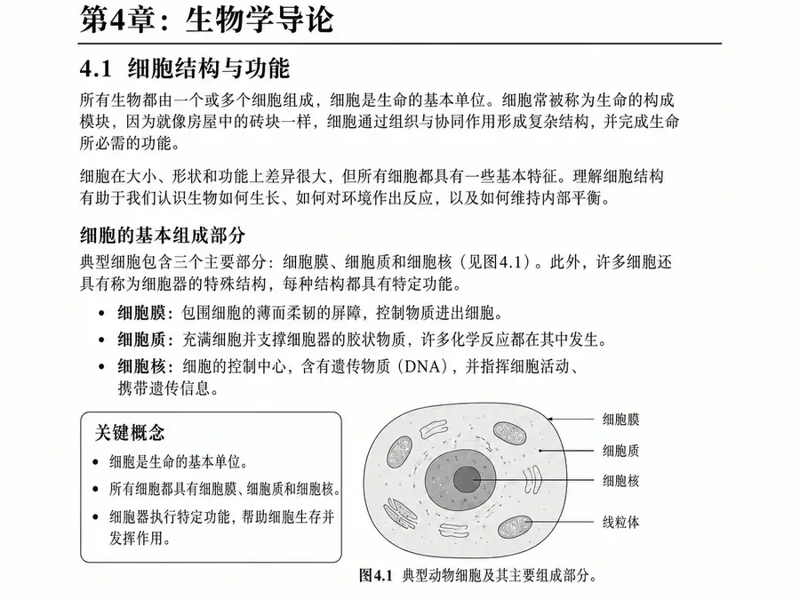
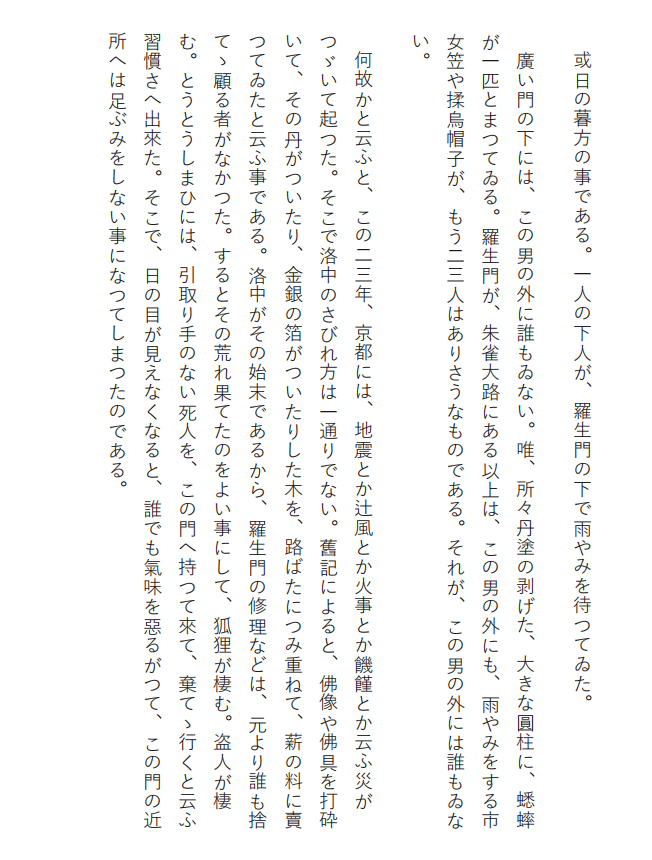
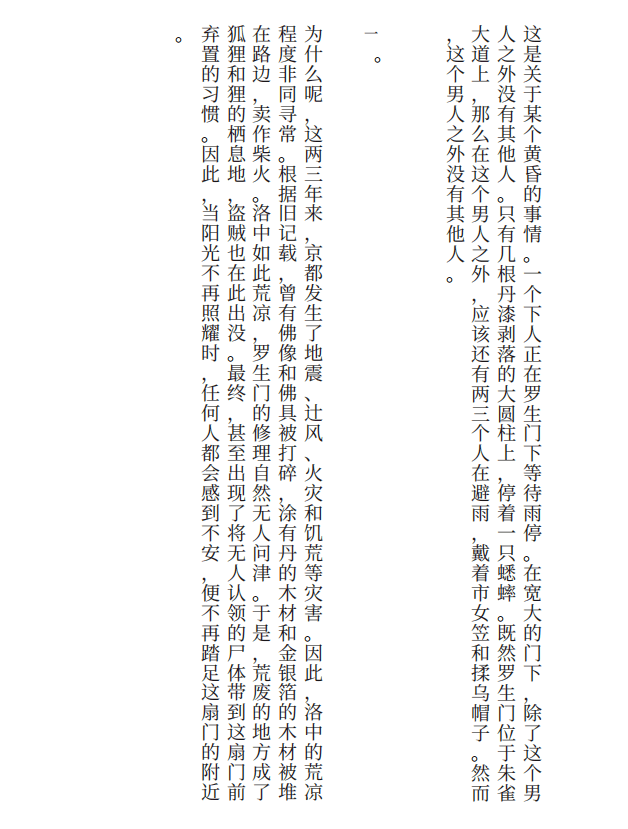

[English](README.md) · [简体中文](README.zh-CN.md) · [Español](README.es.md) · [Português (Brasil)](README.pt-BR.md)

# PDFTranslator.org — Free PDF Translator Online (AI-Powered)

[PDFTranslator.org](https://pdftranslator.org/) translates PDFs into 100+ languages and aims to preserve text layout, tables and images. Download a translation-only PDF for reading or a bilingual PDF to compare with the original.

**Guests get 50 free ordinary PDF pages per calendar month. A free account gets 600 pages per month and 1,000 credits on first registration. Scans that need OCR use credits for the whole file.**

[Translate a PDF online](https://pdftranslator.org/) · [Pricing](https://pdftranslator.org/pricing) · [Feedback and feature requests](https://pdftranslator-org.feedlog.ai/)

This is the official product documentation repository maintained by [SaaSAIHub](https://github.com/SaaSAIHub). It contains guides and translation examples for the hosted website; the application source code and translation engine are not included.

*Guest view on the English homepage.*

## Free AI PDF translation: features and limits

PDFTranslator helps students, researchers, and professionals read foreign-language PDFs without copying and pasting each paragraph into a text translator.

| Feature | Current behavior |
| --- | --- |
| PDF downloads | Translation-only PDF and bilingual PDF with the original and the translation. |
| 100+ languages | Select the source and target languages for your document. |
| Formatting preservation | Designed to retain layout, tables, images, and page structure; review complex documents. |
| Translation styles | General, Academic, Legal, or Business. |

| Access | Free ordinary pages per month | Maximum per file | Queued and processing tasks combined |
| --- | ---: | --- | ---: |
| Guest | 50 | 20 MiB / 200 pages | 2 |
| Free account | 600 | 20 MiB / 200 pages | 2 |
| Active month pass | 600 | 50 MiB / 800 pages | 5 |

A month pass is a one-time purchase valid for 30 days. New tasks receive priority while the pass is active. The pass does not renew automatically.

## How to translate a PDF online

1. Open [PDFTranslator.org](https://pdftranslator.org/) and select or drop your PDF.
2. Choose the document's source language and your target language.
3. Select **General**, or choose **Academic**, **Legal**, or **Business** to match the content.
4. Start the translation and keep the page open for the upload and document check. Eligible tasks using only free pages can enter the queue directly. If credits are required, review the cost and confirm.
5. Follow progress in **Recent translations** on the homepage.
6. Preview your result or download the translation-only or bilingual PDF.

Keep the original and download your result promptly. See the [PDF translation usage guide](docs/usage-guide.md) for file preparation, task limits, and troubleshooting.

## PDF translation examples

These page pairs come from the examples published on the product homepage. The first three show English documents translated into Chinese. The fourth shows a Japanese vertical-text page translated into Chinese.

### Research paper translation

Read a research abstract in another language while keeping paragraphs and keywords in context.

<table>
<tr><th>English original — abstract and keywords</th><th>Chinese translation — abstract and keywords</th></tr>
<tr><td width="50%"></td><td width="50%"></td></tr>
</table>

### Translate PDF handbooks and manuals

Keep section headings, numbered instructions, and lists together when reading a handbook.

<table>
<tr><th>English original — handbook</th><th>Chinese translation — handbook</th></tr>
<tr><td width="50%"></td><td width="50%"></td></tr>
</table>

### Translate PDF textbooks and course materials

Compare explanations, lists, and diagrams while studying a translated textbook page.

<table>
<tr><th>English original — textbook</th><th>Chinese translation — textbook</th></tr>
<tr><td width="50%"></td><td width="50%"></td></tr>
</table>

### Vertical Japanese text

Follow the columns from right to left and check where dialogue and punctuation fall in the translation.

<table>
<tr><th>Japanese original</th><th>Chinese translation</th></tr>
<tr><td width="50%"></td><td width="50%"></td></tr>
</table>

For a closer review of terminology, tables, figures, and reading order, use the [translation and formatting checklist](docs/translation-review.md).

## Supported languages and PDF translation use cases

PDFTranslator.org supports 100+ translation languages, including English, Chinese, Spanish, French, German, Portuguese, Japanese, and Korean. The interface language and the document's translation languages are separate choices.

| Reading goal | What to select |
| --- | --- |
| Translate a PDF from English to Spanish | Choose English as the source and Spanish as the target. |
| Translate a PDF document to English | Choose the document's actual source language and English as the target. |
| Translate a PDF to German | Choose the source language and German as the target. |
| Translate an English PDF to Chinese or Portuguese | Choose English and the corresponding target-language option. |

Use **Academic** for research papers and course materials, **Business** for reports and business documents, and **General** for everyday reading and manuals. **Legal** is available for legal terminology; review consequential wording before relying on it.

Website interfaces: [English](https://pdftranslator.org/) · [中文](https://pdftranslator.org/zh) · [Español](https://pdftranslator.org/es) · [Português (Brasil)](https://pdftranslator.org/pt-BR).

## FAQ about PDF translation

### Is PDFTranslator.org a free PDF translator without sign-up?

Yes. Guests can translate 50 ordinary pages each calendar month. With an account, ordinary PDFs use the 600 monthly free pages first, then 10 credits for each additional page. Unused free pages do not carry over.

### Can I translate a PDF without losing formatting?

PDFTranslator.org aims to preserve the layout, tables, images, and page structure. Translated text can take more or less space than the original. Check complex tables, formulas, fonts, and page breaks; exact formatting is not guaranteed.

### Can I translate long PDF documents?

Guests and free accounts can upload up to 200 pages and 20 MiB per file. An active month pass raises those limits to 800 pages and 50 MiB. Split a document to translate selected chapters within your allowance.

### Can I translate a scanned PDF?

Upload the scan directly. If the check finds it needs OCR, sign in and review the quote. Every page in the file costs 20 credits, even if only some pages need recognition. Welcome credits can cover OCR. Ordinary free pages do not apply.

### Does the service produce a Word document?

The main translation workflow accepts PDFs and returns translated PDFs. This repository does not describe a PDF-to-Word converter or editable DOCX output.

### How long can I access my translated PDF?

Task history is visible for 24 hours after completion, failure or cancellation. Preview or download a successful result within 24 hours of completion, even with a month pass. Check the expiry on the task card.

### Are my files processed locally?

Translation runs on the server. Guest history is saved in the current browser, while signed-in history is managed by the service. Storage copies and necessary business records may remain after access expires. See the [file-handling guide](docs/privacy.md).

### What happens if a task fails or I cancel it?

You can cancel a queued task until processing begins. After a failure or successful cancellation, the service returns the pages and credits used. Free pages go back to their original month.

### Is this an open-source translator or a public API package?

This repository contains official documentation for the hosted PDFTranslator.org website. It does not include a self-hosted application, translation engine, or public API package.

## Guides, PDF tools and feedback

- [How to translate PDF files: usage and troubleshooting](docs/usage-guide.md)
- [PDF translation quality and formatting review](docs/translation-review.md)
- [File uploads, retention, and privacy](docs/privacy.md)
- [Split PDF](https://pdftranslator.org/tools/split-pdf) · [Merge PDF](https://pdftranslator.org/tools/merge-pdf) · [More PDF tools](https://pdftranslator.org/tools)
- [Report a problem or suggest a feature on FeedLog](https://pdftranslator-org.feedlog.ai/)
- [Contribute a documentation correction](CONTRIBUTING.md)

Use non-sensitive examples when reporting a problem. Do not publish private documents, task identifiers, or signed upload/download links.

**Product details last checked: November 2, 2026.** Features and limits may change; the [live website](https://pdftranslator.org/), [Privacy Policy](https://pdftranslator.org/privacy-policy), and [Terms of Service](https://pdftranslator.org/terms-of-service) describe the current service.
