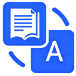
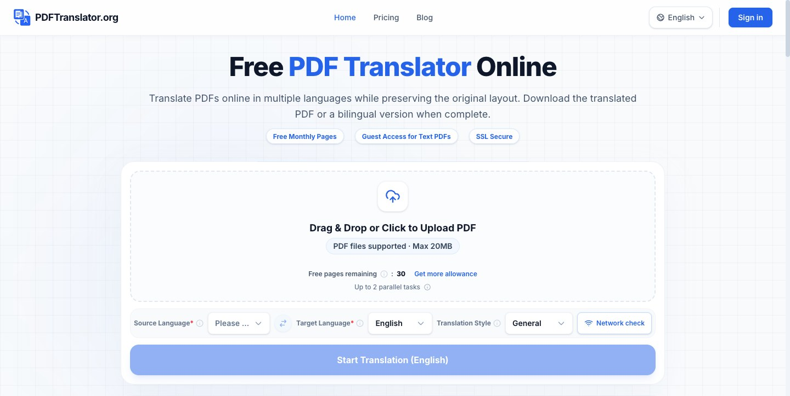
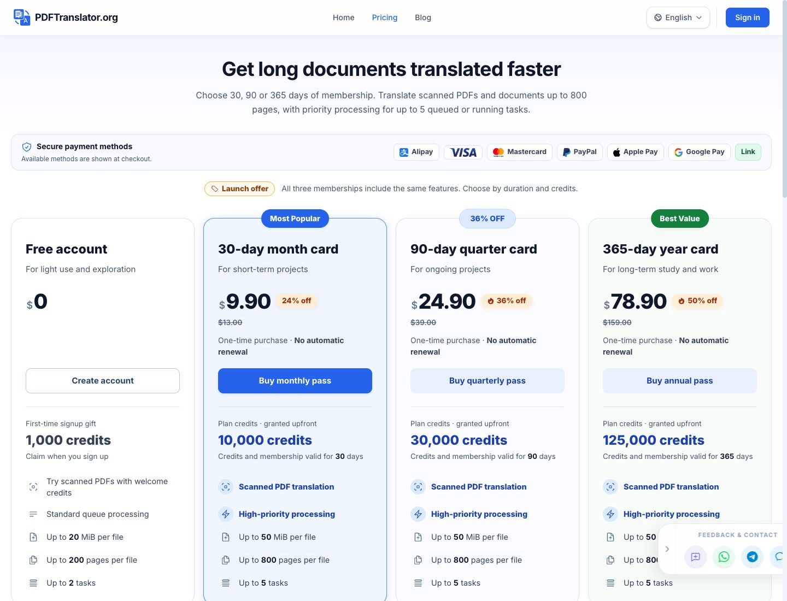

[English](README.md) · [简体中文](README.zh-CN.md) · [Español](README.es.md) · [Português (Brasil)](README.pt-BR.md)

# PDFTranslator.org — Free PDF Translator Online (AI-Powered)

[PDFTranslator.org](https://pdftranslator.org/) translates PDFs into 100+ languages and aims to preserve text layout, tables and images. Download a translation-only PDF for reading or a side-by-side bilingual PDF to compare with the original.

**Guests get 30 free ordinary PDF pages per calendar month. A free account gets 100 pages per month and 1,000 credits on first registration. Scans that need OCR use credits for the whole file.**

[Translate a PDF online](https://pdftranslator.org/) · [Pricing](https://pdftranslator.org/pricing) · [Feedback and feature requests](https://pdftranslator-org.feedlog.ai/)

This is the official product documentation repository maintained by [SaaSAIHub](https://github.com/SaaSAIHub). It contains guides and translation examples for the hosted website; the application source code and translation engine are not included.

*Guest view on the English homepage.*

## Free AI PDF translation: features and limits

PDFTranslator helps students, researchers, and professionals read foreign-language PDFs without copying and pasting each paragraph into a text translator.

| Feature | Current behavior |
| --- | --- |
| PDF downloads | Translation-only PDF and side-by-side bilingual PDF with the original and the translation. |
| 100+ languages | Select the source and target languages for your document. |
| Formatting preservation | Designed to retain layout, tables, images, and page structure; review complex documents. |
| Translation styles | General, Academic, Legal, or Business; unavailable for some languages. |

| Access | Free ordinary pages per month | Maximum per file | Queued and processing tasks combined |
| --- | ---: | --- | ---: |
| Guest | 30 | 20 MiB / 200 pages | 2 |
| Free account | 100 | 20 MiB / 200 pages | 2 |
| Active membership | 100 | 50 MiB / 800 pages | 5 |

Membership passes are one-time purchases for **30, 90 or 365 days**. Each purchase grants its credits upfront, with validity starting from successful payment. Membership adds priority and higher limits; it does not add monthly free pages or renew automatically. New purchases do not extend old credit expiry or stack task limits. See [current plans](https://pdftranslator.org/pricing). The one-time 1,000 welcome credits expire on the matching date of the following month, or its last day if needed.

*Current membership options on the live pricing page (English interface). Prices and availability are shown on the website.*

## PDF Translator Comparison: Google Translate, DeepL & More

Compare PDFTranslator.org with Online DocTranslator, iLovePDF and Smallpdf for layout, scanned PDFs and bilingual downloads.

| Feature | **PDFTranslator.org** Recommended | [Google Translate](https://support.google.com/translate/answer/2534559?hl=en) | [DeepL](https://support.deepl.com/hc/en-us/articles/4411308018450-Translate-PDF-files) | [Online DocTranslator](https://www.onlinedoctranslator.com/en/translate-english-to-slovak_en_sk) | [iLovePDF](https://www.ilovepdf.com/blog/introducing-translate-pdf-ai-pdf-translation) | [Smallpdf](https://smallpdf.com/translate-pdf) |
| --- | --- | --- | --- | --- | --- | --- |
| **Bilingual PDF Downloads** Original and translation side by side | ✅ **Supported** Monolingual and bilingual PDFs included | ❌ **Not offered** | ❌ **Not offered** | ❌ **Not offered** | ❌ **Not offered** | ❌ **Not offered** Side-by-side view on the website only |
| **Selectable Translation Styles** Choose by document purpose | ✅ **4 presets** General, academic, legal and business | ℹ️ **No option found** | ⚠️ **Tone selection** Pro; selected languages | ℹ️ **No option found** | ℹ️ **No option found** | ℹ️ **No option found** |
| **Layout Preservation** Translated layout and images | ✅ **Preserves layout** Original PDF structure | ⚠️ **Complex layouts break** | ⚠️ **Preserves formatting** Free results have a watermark | ⚠️ **Complex layouts break** | ⚠️ **Complex layouts break** | ⚠️ **Complex layouts break** |
| **OCR Support** Translation of scanned PDFs | ✅ **Supported** Sign in and use credits | ❌ **Not supported** Scanned PDF text is not translated | ✅ **Supported** Results depend on scan quality | ⚠️ **External OCR required** Convert to Word first | ✅ **Supported** Built-in OCR | ✅ **Supported** Built-in OCR |
| **File Size Limit** Free and paid limits differ | ✅ **20 MiB / 200 pages** Members: 50 MiB / 800 pages | **10 MB / 300 pages** | **5 MB** Free account | **Not confirmed** Official pages reviewed do not specify | **15 MB free** Premium: 200 MB | **Not confirmed** Official pages reviewed do not specify |
| **Free Usage** Allowances and billing | **Monthly free pages** Guests: 30 pages; accounts: 100 pages; first-time sign-ups also receive 1,000 free credits | **Free** Document translation | **Free account allowance** Check your account | **Free** Document translation | **One free trial only** Payment required beyond the allowance; check the tool | **Limited free use** Unlimited on paid plans |
| **Account Requirements** Getting started | **No registration** For text PDFs | **No login step** In the official instructions | **Account required** | **No registration** | **Depends on the tool** Check current requirements | **No registration** |

Checked on November 25, 2026, using official sources and hands-on web tests. Brand links open official sources.

Test results apply to the documents and account conditions tested; features and limits vary by plan. Layout results vary by document.

PDFTranslator.org free pages exclude OCR; style selection is unavailable for some languages.

## How to translate a PDF online

1. Open [PDFTranslator.org](https://pdftranslator.org/) and select or drop your PDF.
2. Choose the document's source language and your target language.
3. Select **General**, or choose **Academic**, **Legal**, or **Business** to match the content.
4. Start the translation and keep the page open for the upload and document check. Eligible tasks using only free pages can enter the queue directly. If credits are required, review the cost and confirm.
5. Follow progress in **Recent translations** on the homepage.
6. Preview your result or download the translation-only or bilingual PDF.

Keep the original and download your result promptly. See the [PDF translation usage guide](docs/usage-guide.md) for file preparation, task limits, and troubleshooting.

## PDF translation examples

These page pairs come from the examples published on the product homepage. The first three show English documents translated into Chinese. The fourth shows a Japanese vertical-text page translated into Chinese.

### Research paper translation

Read a research abstract in another language while keeping paragraphs and keywords in context.

<table>
<tr><th>English original — abstract and keywords</th><th>Chinese translation — abstract and keywords</th></tr>
<tr><td width="50%"></td><td width="50%"></td></tr>
</table>

### Translate PDF handbooks and manuals

Keep section headings, numbered instructions, and lists together when reading a handbook.

<table>
<tr><th>English original — handbook</th><th>Chinese translation — handbook</th></tr>
<tr><td width="50%"></td><td width="50%"></td></tr>
</table>

### Translate PDF textbooks and course materials

Compare explanations, lists, and diagrams while studying a translated textbook page.

<table>
<tr><th>English original — textbook</th><th>Chinese translation — textbook</th></tr>
<tr><td width="50%"></td><td width="50%"></td></tr>
</table>

### Vertical Japanese text

Follow the columns from right to left and check where dialogue and punctuation fall in the translation.

<table>
<tr><th>Japanese original</th><th>Chinese translation</th></tr>
<tr><td width="50%"></td><td width="50%"></td></tr>
</table>

For a closer review of terminology, tables, figures, and reading order, use the [translation and formatting checklist](docs/translation-review.md).

## Supported languages and PDF translation use cases

The website has nine interface languages: English, Chinese, Japanese, Korean, German, French, Spanish, Vietnamese and Brazilian Portuguese. The following dedicated landing pages currently have an **English interface**; source and target languages can be changed before submission, and restored drafts keep their original settings.

PDFTranslator.org supports 100+ translation languages, including English, Chinese, Spanish, French, German, Portuguese, Japanese, and Korean. The interface language and the document's translation languages are separate choices.

| Reading goal | What to select |
| --- | --- |
| [Translate PDF to Spanish](https://pdftranslator.org/translate/pdf-to-spanish) | English → Spanish initially; choose another source if needed. |
| [Translate German PDF to English](https://pdftranslator.org/translate/german-to-english) | German → English. |
| [English to Tamil PDF Translator](https://pdftranslator.org/translate/english-to-tamil) | English → Tamil. |
| Translate an English PDF to Chinese or Portuguese | Choose English and the corresponding target-language option. |

Use **Academic** for research papers and course materials, **Business** for reports and business documents, and **General** for everyday reading and manuals. **Legal** is available for legal terminology; review consequential wording before relying on it.

Website interfaces: [English](https://pdftranslator.org/) · [中文](https://pdftranslator.org/zh) · [Español](https://pdftranslator.org/es) · [Português (Brasil)](https://pdftranslator.org/pt-BR).

## FAQ about PDF translation

### Is PDFTranslator.org a free PDF translator without sign-up?

Yes. Guests can translate 30 ordinary pages each calendar month. With an account, ordinary PDFs use the 100 monthly free pages first, then 10 credits for each additional page. Unused free pages do not carry over.

### Can I translate a PDF without losing formatting?

PDFTranslator.org aims to preserve the layout, tables, images, and page structure. Translated text can take more or less space than the original. Check complex tables, formulas, fonts, and page breaks; exact formatting is not guaranteed.

### Can I translate long PDF documents?

Guests and free accounts can upload up to 200 pages and 20 MiB per file. An active membership pass raises those limits to 800 pages and 50 MiB. Split a document to translate selected chapters within your allowance.

### Can I translate a scanned PDF?

Upload the scan directly. If the check finds it needs OCR, sign in and review the quote. Every page in the file costs 20 credits, even if only some pages need recognition. Welcome credits can cover OCR. Ordinary free pages do not apply.

### Does the service produce a Word document?

The main translation workflow accepts PDFs and returns translated PDFs. This repository does not describe a PDF-to-Word converter or editable DOCX output.

### How long can I access my translated PDF?

Task history is visible for 24 hours after completion, failure or cancellation. Preview or download a successful result within 24 hours of completion, even with a membership pass. Check the expiry on the task card.

### Are my files processed locally?

Translation runs on the server. Guest history is saved in the current browser, while signed-in history is managed by the service. Storage copies and necessary business records may remain after access expires. See the [file-handling guide](docs/privacy.md).

### What happens if a task fails or I cancel it?

You can cancel a queued task until processing begins. After a failure or successful cancellation, the service returns the pages and credits used. Free pages go back to their original month.

### Is this an open-source translator or a public API package?

This repository contains official documentation for the hosted PDFTranslator.org website. It does not include a self-hosted application, translation engine, or public API package.

## Guides, PDF tools and feedback

- [How to translate PDF files: usage and troubleshooting](docs/usage-guide.md)
- [PDF translation quality and formatting review](docs/translation-review.md)
- [File uploads, retention, and privacy](docs/privacy.md)
- [Split PDF](https://pdftranslator.org/tools/split-pdf) · [Merge PDF](https://pdftranslator.org/tools/merge-pdf) · [More PDF tools](https://pdftranslator.org/tools)
- [Report a problem or suggest a feature on FeedLog](https://pdftranslator-org.feedlog.ai/)
- [Web to PDF](https://pdftranslator.org/tools/web-to-pdf) · [Gmail to PDF](https://pdftranslator.org/tools/gmail-to-pdf)
- [Current product facts and sources](docs/current-product-facts.md)
- [Contribute a documentation correction](CONTRIBUTING.md)

Use non-sensitive examples when reporting a problem. Do not publish private documents, task identifiers, or signed upload/download links.

**Product details last checked: November 25, 2026.** Features and limits may change; the [live website](https://pdftranslator.org/), [Privacy Policy](https://pdftranslator.org/privacy-policy), and [Terms of Service](https://pdftranslator.org/terms-of-service) describe the current service.
