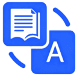
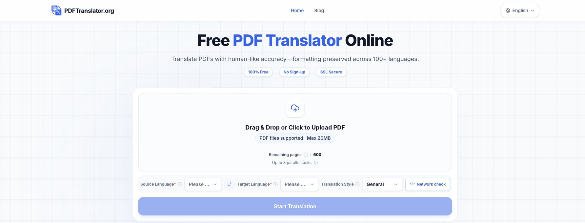
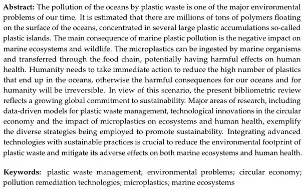
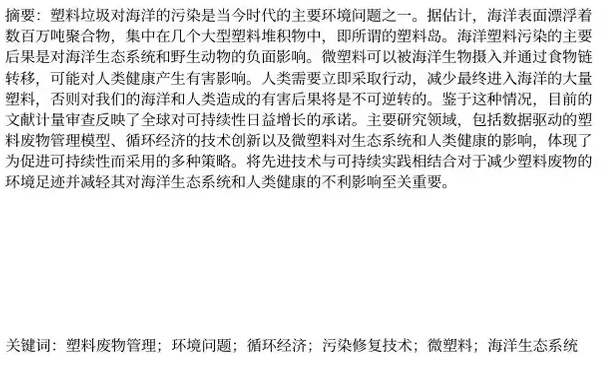
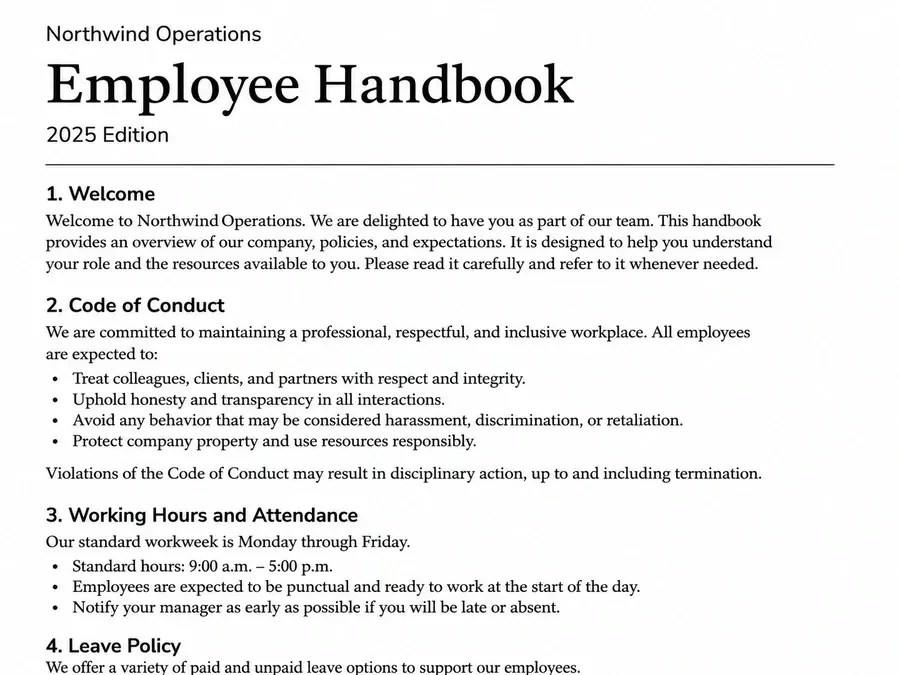
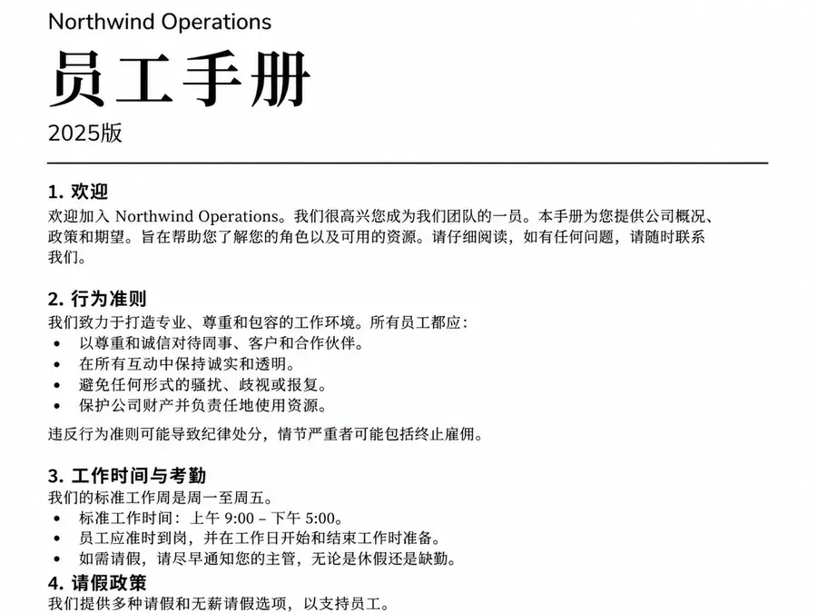
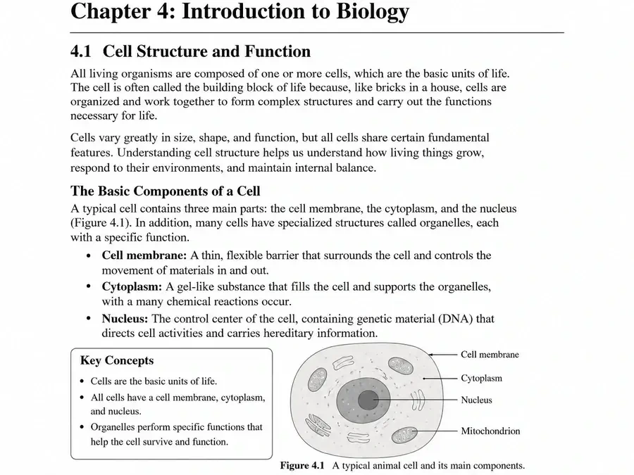
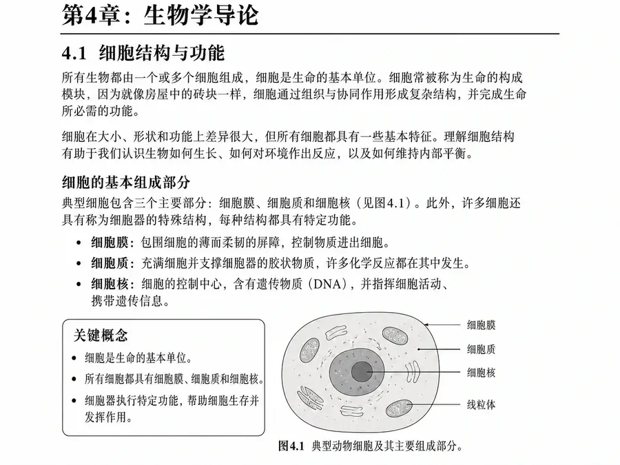

[English](README.md) · [简体中文](README.zh-CN.md) · [Español](README.es.md) · [Português (Brasil)](README.pt-BR.md)

# PDFTranslator.org — Tradutor de PDF online grátis com IA

[PDFTranslator.org](https://pdftranslator.org/pt-BR) é um tradutor de PDF online com IA para traduzir documentos PDF completos para mais de 100 idiomas. Envie um PDF, selecione os idiomas de origem e destino e, ao concluir, visualize ou baixe o PDF traduzido. O serviço busca preservar a disposição do texto, as tabelas, as imagens e a estrutura das páginas tanto quanto possível.

**Sem cadastro. Até 20MB por PDF. 600 páginas grátis por mês-calendário.**

[Traduzir um PDF online](https://pdftranslator.org/pt-BR) · [Feedback e sugestões](https://pdftranslator-org.feedlog.ai/)

Este é o repositório oficial de documentação do produto, mantido por [SaaSAIHub](https://github.com/SaaSAIHub). Ele reúne guias e exemplos do serviço online; não inclui o código-fonte da aplicação nem o mecanismo de tradução.

## Tradução de PDF com IA: recursos e limites

O PDFTranslator ajuda estudantes, pesquisadores e profissionais a ler PDFs em outros idiomas sem copiar e colar cada parágrafo em um tradutor de texto.

| Recurso | Funcionamento atual |
| --- | --- |
| Entrada e saída em PDF | Envie um PDF e visualize ou baixe o PDF traduzido. |
| Mais de 100 idiomas | Escolha os idiomas de origem e destino do documento. |
| Preservação da formatação | Busca manter o layout, as tabelas, as imagens e a estrutura; revise documentos complexos. |
| Estilos de tradução | Geral, Acadêmico, Jurídico ou Empresarial. |
| Cota mensal gratuita | 600 páginas por mês-calendário, renovadas no início de cada mês. |
| Tamanho do arquivo | Até 20MB por PDF. |
| Tarefas simultâneas | Até 3 tarefas na fila ou em processamento; ambas ocupam uma vaga. |
| Sem cadastro | Use pelo navegador, sem conta nem instalação. |
| Traduções recentes | Acompanhe as tarefas no mesmo navegador e salve os resultados assim que possível. |

## Como traduzir um PDF online

1. Abra o [PDFTranslator.org](https://pdftranslator.org/pt-BR) e selecione ou arraste seu PDF.
2. Escolha o idioma original do documento e o idioma de destino.
3. Selecione Geral ou um estilo especializado: Acadêmico, Jurídico ou Empresarial.
4. Inicie a tradução. Mantenha a página aberta até terminar o envio e a criação da tarefa.
5. Acompanhe o andamento nas traduções recentes da página inicial.
6. Visualize ou baixe o PDF concluído e compare o conteúdo importante e a formatação com o original.

Guarde o original e baixe o resultado assim que possível. Consulte o [guia de uso em inglês](docs/usage-guide.md) para preparar arquivos, entender os limites e resolver problemas.

## Exemplos de tradução de PDF: artigos, manuais e livros didáticos

As comparações do inglês para o chinês abaixo vêm das demonstrações publicadas do produto. Elas mostram texto e estrutura de páginas específicas; não garantem o mesmo resultado para qualquer PDF ou combinação de idiomas.

### Tradução de artigos científicos em PDF

Leia um resumo de pesquisa em outro idioma, mantendo o contexto dos parágrafos e das palavras-chave.

<table>
<tr><th>Original em inglês: resumo e palavras-chave</th><th>Tradução em chinês: resumo e palavras-chave</th></tr>
<tr><td width="50%"></td><td width="50%"></td></tr>
</table>

### Traduzir manuais e guias em PDF

Consulte títulos de seção, instruções numeradas e listas juntos ao ler um manual.

<table>
<tr><th>Original em inglês: manual</th><th>Tradução em chinês: manual</th></tr>
<tr><td width="50%"></td><td width="50%"></td></tr>
</table>

### Traduzir livros didáticos e materiais de estudo em PDF

Compare explicações, listas e diagramas ao estudar uma página traduzida.

<table>
<tr><th>Original em inglês: livro didático</th><th>Tradução em chinês: livro didático</th></tr>
<tr><td width="50%"></td><td width="50%"></td></tr>
</table>

Para revisar terminologia, tabelas, figuras e ordem de leitura, use o [guia de revisão de tradução e formatação em inglês](docs/translation-review.md).

## Idiomas disponíveis e usos da tradução de PDF

O PDFTranslator.org oferece mais de 100 idiomas de tradução, incluindo inglês, chinês, espanhol, francês, alemão, português, japonês e coreano. O idioma da interface e os idiomas de tradução do documento são escolhas separadas.

| Objetivo | O que selecionar |
| --- | --- |
| Traduzir PDF de inglês para espanhol | Inglês como origem e espanhol como destino. |
| Traduzir um documento PDF para inglês | O idioma real do documento como origem e inglês como destino. |
| Traduzir PDF para alemão | O idioma de origem e alemão como destino. |
| Traduzir PDF de inglês para chinês ou português | Inglês como origem e a opção de destino correspondente. |

Escolha Acadêmico para artigos e materiais de estudo; Empresarial para relatórios e documentos de negócios; e Geral para leituras cotidianas e manuais. O estilo Jurídico está disponível para terminologia jurídica; revise trechos usados em decisões importantes.

Interfaces do site: [English](https://pdftranslator.org/) · [中文](https://pdftranslator.org/zh) · [Español](https://pdftranslator.org/es) · [Português (Brasil)](https://pdftranslator.org/pt-BR).

## Perguntas frequentes sobre tradução de PDF

### O PDFTranslator.org traduz PDF grátis e sem cadastro?

Sim. Atualmente, o serviço inclui 600 páginas gratuitas por mês-calendário, sem cadastro. A cota é renovada no início de cada mês. Cada PDF pode ter até 20MB e são permitidas até 3 tarefas na fila ou em processamento ao mesmo tempo.

### Posso traduzir um PDF sem perder a formatação?

O serviço busca preservar o layout, as tabelas, as imagens e a estrutura das páginas. O texto traduzido pode ocupar mais ou menos espaço. Revise tabelas complexas, fórmulas, fontes e quebras de página; a reprodução exata não é garantida.

### Posso traduzir PDFs longos?

Sim, respeitando o limite de 20MB, a cota mensal restante e os limites exibidos pelo serviço. Dividir um PDF ajuda a selecionar capítulos ou reduzir o tamanho de cada arquivo, mas não aumenta a cota gratuita.

### Posso traduzir um PDF digitalizado?

PDFs compostos apenas por imagens podem precisar de OCR antes da tradução. Se o site não conseguir extrair texto, siga as orientações exibidas ou use uma ferramenta de OCR para criar um PDF com texto extraível. Revise o texto reconhecido antes de traduzi-lo.

### O resultado é um documento do Word?

O fluxo principal recebe PDFs e entrega PDFs traduzidos. Este repositório não descreve um conversor de PDF para Word nem promete arquivos DOCX editáveis.

### Por quanto tempo posso baixar o PDF traduzido?

A política de privacidade publicada informa que os resultados e seus links ficam disponíveis por até 24 horas após a conclusão da tarefa. Os registros locais do navegador duram até 24 horas após a criação da tarefa: são prazos diferentes. Salve sua própria cópia assim que possível.

### Os arquivos são processados apenas no meu dispositivo?

Não. A tradução exige o envio do documento para processamento em servidores. Segundo a [política de privacidade](https://pdftranslator.org/privacy-policy), os PDFs originais e arquivos de tarefas canceladas ou com falha são excluídos em até 24 horas após o envio. Consulte o [guia de privacidade em inglês](docs/privacy.md).

### Este é um tradutor de código aberto ou um pacote de API pública?

Este repositório contém a documentação oficial do site PDFTranslator.org. Não inclui uma aplicação para hospedagem própria, um mecanismo de tradução ou um pacote de API pública.

## Guias, ferramentas PDF e feedback

- [Uso e solução de problemas na tradução de PDF — inglês](docs/usage-guide.md)
- [Revisão da qualidade e da formatação — inglês](docs/translation-review.md)
- [Envio de arquivos, retenção e privacidade — inglês](docs/privacy.md)
- [Dividir PDF](https://pdftranslator.org/tools/split-pdf) · [Unir PDF](https://pdftranslator.org/tools/merge-pdf) · [Mais ferramentas PDF](https://pdftranslator.org/tools)
- [Relatar um problema ou sugerir um recurso no FeedLog](https://pdftranslator-org.feedlog.ai/)
- [Contribuir com a documentação — inglês](CONTRIBUTING.md)

Use exemplos sem informações sensíveis no feedback público. Não publique documentos privados, identificadores de tarefas ou links assinados de envio e download.

**Informações do produto verificadas em 18 de outubro de 2026.** Recursos e limites podem mudar; consulte o [site oficial](https://pdftranslator.org/pt-BR), a [política de privacidade](https://pdftranslator.org/privacy-policy) e os [termos de serviço](https://pdftranslator.org/terms-of-service).
