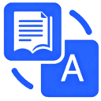
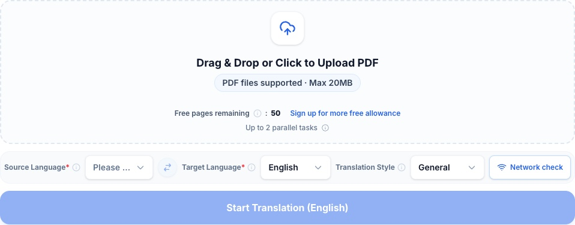
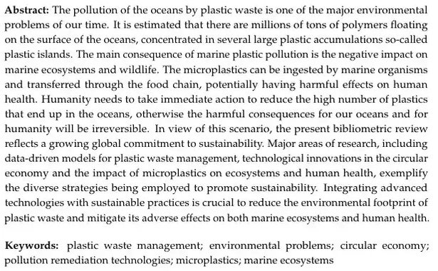
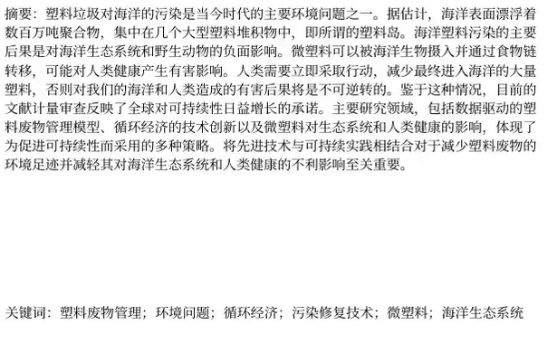
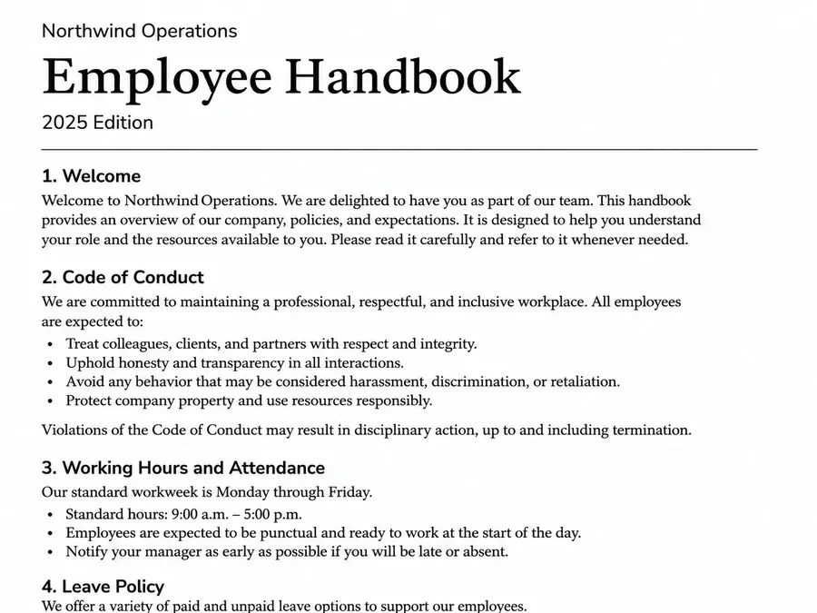
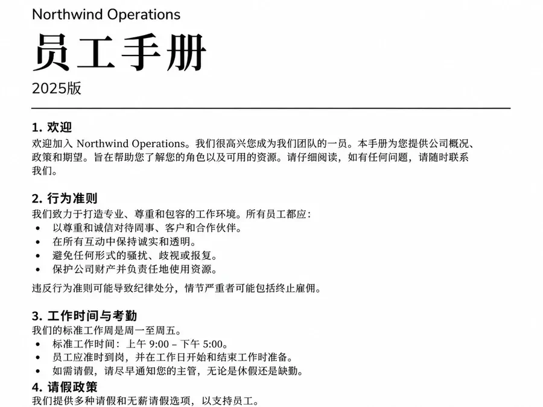
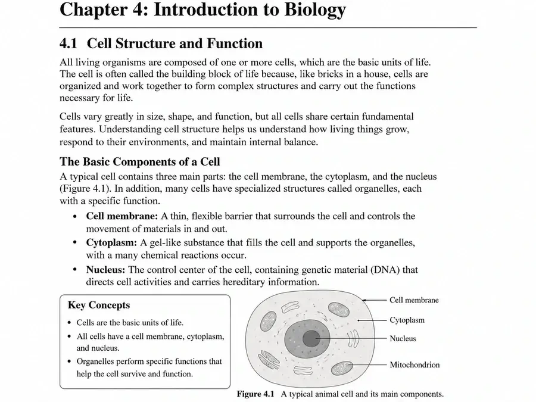
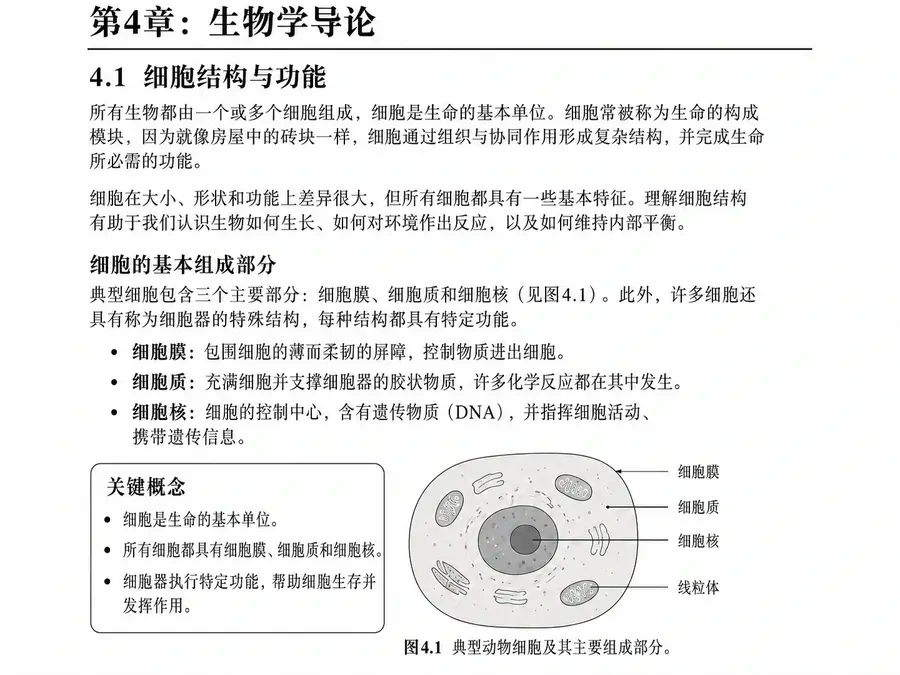
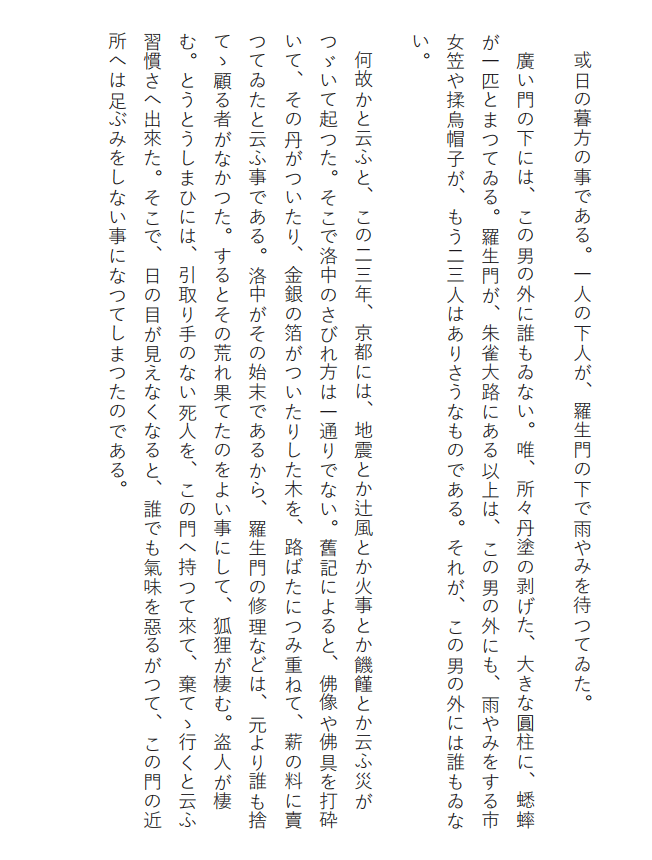
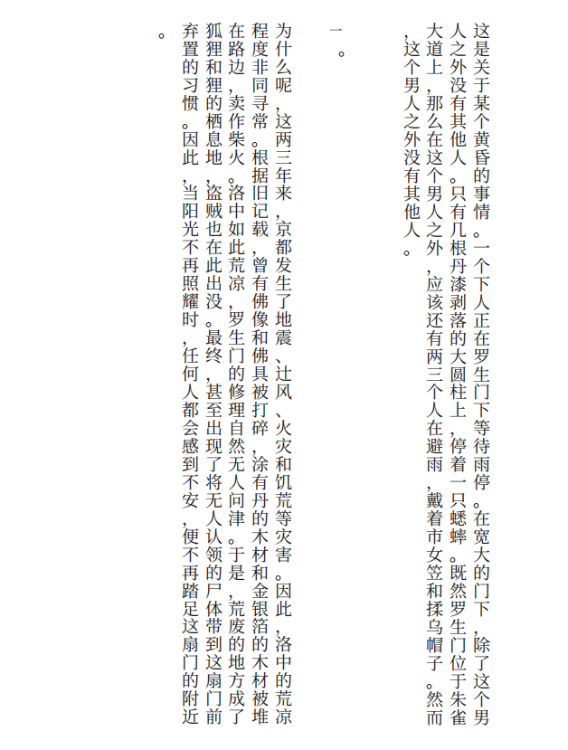

[English](README.md) · [简体中文](README.zh-CN.md) · [Español](README.es.md) · [Português (Brasil)](README.pt-BR.md)

# PDFTranslator.org — Tradutor de PDF online grátis com IA

O [PDFTranslator.org](https://pdftranslator.org/pt-BR) traduz PDFs para mais de 100 idiomas e procura preservar a disposição do texto, das tabelas e das imagens. Baixe um PDF só com a tradução ou a versão bilíngue para comparar com o original.

**Visitantes têm 50 páginas gratuitas de PDFs comuns por mês-calendário. Uma conta gratuita inclui 600 páginas por mês e um bônus único de 1.000 créditos no cadastro. Se o documento digitalizado precisar de OCR, a cobrança em créditos abrange o arquivo inteiro.**

[Traduzir um PDF online](https://pdftranslator.org/pt-BR) · [Planos e preços](https://pdftranslator.org/pt-BR/pricing) · [Feedback e sugestões](https://pdftranslator-org.feedlog.ai/)

Este é o repositório oficial de documentação do produto, mantido por [SaaSAIHub](https://github.com/SaaSAIHub). Ele reúne guias e exemplos do serviço online; não inclui o código-fonte da aplicação nem o mecanismo de tradução.

*Visualização de visitante na página inicial em inglês.*

## Tradução de PDF com IA: recursos e limites

O PDFTranslator ajuda estudantes, pesquisadores e profissionais a ler PDFs em outros idiomas sem copiar e colar cada parágrafo em um tradutor de texto.

| Recurso | Funcionamento atual |
| --- | --- |
| Downloads em PDF | PDF só com a tradução ou PDF bilíngue com o original e a tradução. |
| Mais de 100 idiomas | Escolha os idiomas de origem e destino do documento. |
| Preservação da formatação | Busca manter o layout, as tabelas, as imagens e a estrutura; revise documentos complexos. |
| Estilos de tradução | Geral, Acadêmico, Jurídico ou Empresarial. |

| Tipo de acesso | Páginas comuns gratuitas por mês | Máximo por arquivo | Total de tarefas na fila e em processamento |
| --- | ---: | --- | ---: |
| Visitante | 50 | 20 MiB / 200 páginas | 2 |
| Conta gratuita | 600 | 20 MiB / 200 páginas | 2 |
| Passe mensal ativo | 600 | 50 MiB / 800 páginas | 5 |

O passe mensal tem pagamento único e vale por 30 dias. Novas tarefas ganham prioridade enquanto o passe estiver ativo. Não há renovação automática.

## Como traduzir um PDF online

1. Abra o [PDFTranslator.org](https://pdftranslator.org/pt-BR) e selecione ou arraste seu PDF.
2. Escolha o idioma original do documento e o idioma de destino.
3. Selecione Geral ou um estilo especializado: Acadêmico, Jurídico ou Empresarial.
4. Inicie a tradução e mantenha a página aberta durante o envio e a verificação do arquivo. Se o saldo de páginas gratuitas cobrir a tradução e os limites forem respeitados, a tarefa entra direto na fila. Se precisar de créditos, confira o custo e confirme.
5. Acompanhe o andamento nas traduções recentes da página inicial.
6. Visualize o resultado ou baixe o PDF só com a tradução ou a versão bilíngue.

Guarde o original e baixe o resultado assim que possível. Consulte o [guia de uso em inglês](docs/usage-guide.md) para preparar arquivos, entender os limites e resolver problemas.

## Exemplos de tradução de PDF

Estes pares de páginas vêm dos exemplos publicados no site. Os três primeiros mostram traduções do inglês para o chinês. O quarto mostra a tradução para o chinês de uma página em japonês com escrita vertical.

### Tradução de artigos científicos em PDF

Leia um resumo de pesquisa em outro idioma, mantendo o contexto dos parágrafos e das palavras-chave.

<table>
<tr><th>Original em inglês: resumo e palavras-chave</th><th>Tradução em chinês: resumo e palavras-chave</th></tr>
<tr><td width="50%"></td><td width="50%"></td></tr>
</table>

### Traduzir manuais e guias em PDF

Consulte títulos de seção, instruções numeradas e listas juntos ao ler um manual.

<table>
<tr><th>Original em inglês: manual</th><th>Tradução em chinês: manual</th></tr>
<tr><td width="50%"></td><td width="50%"></td></tr>
</table>

### Traduzir livros didáticos e materiais de estudo em PDF

Compare explicações, listas e diagramas ao estudar uma página traduzida.

<table>
<tr><th>Original em inglês: livro didático</th><th>Tradução em chinês: livro didático</th></tr>
<tr><td width="50%"></td><td width="50%"></td></tr>
</table>

### Tradução de texto japonês na vertical

Acompanhe as colunas da direita para a esquerda e confira a posição das falas e dos sinais de pontuação.

<table>
<tr><th>Original em japonês</th><th>Tradução para o chinês</th></tr>
<tr><td width="50%"></td><td width="50%"></td></tr>
</table>

Para revisar terminologia, tabelas, figuras e ordem de leitura, use o [guia de revisão de tradução e formatação em inglês](docs/translation-review.md).

## Idiomas disponíveis e usos da tradução de PDF

O PDFTranslator.org oferece mais de 100 idiomas de tradução, incluindo inglês, chinês, espanhol, francês, alemão, português, japonês e coreano. O idioma da interface e os idiomas de tradução do documento são escolhas separadas.

| Objetivo | O que selecionar |
| --- | --- |
| Traduzir PDF de inglês para espanhol | Inglês como origem e espanhol como destino. |
| Traduzir um documento PDF para inglês | O idioma real do documento como origem e inglês como destino. |
| Traduzir PDF para alemão | O idioma de origem e alemão como destino. |
| Traduzir PDF de inglês para chinês ou português | Inglês como origem e a opção de destino correspondente. |

Escolha Acadêmico para artigos e materiais de estudo; Empresarial para relatórios e documentos de negócios; e Geral para leituras cotidianas e manuais. O estilo Jurídico está disponível para terminologia jurídica; revise trechos usados em decisões importantes.

Interfaces do site: [English](https://pdftranslator.org/) · [中文](https://pdftranslator.org/zh) · [Español](https://pdftranslator.org/es) · [Português (Brasil)](https://pdftranslator.org/pt-BR).

## Perguntas frequentes sobre tradução de PDF

### O PDFTranslator.org traduz PDF grátis e sem cadastro?

Sim. Visitantes podem traduzir gratuitamente 50 páginas de PDFs comuns por mês-calendário. Com uma conta, você usa primeiro as 600 páginas gratuitas do mês e paga 10 créditos por página excedente. As páginas gratuitas não acumulam.

### Posso traduzir um PDF sem perder a formatação?

O serviço busca preservar o layout, as tabelas, as imagens e a estrutura das páginas. O texto traduzido pode ocupar mais ou menos espaço. Revise tabelas complexas, fórmulas, fontes e quebras de página; a reprodução exata não é garantida.

### Posso traduzir PDFs longos?

Visitantes e contas gratuitas podem enviar até 200 páginas e 20 MiB por arquivo. Com um passe mensal ativo, os limites sobem para 800 páginas e 50 MiB. Você pode dividir o PDF para traduzir apenas os capítulos desejados.

### Posso traduzir um PDF digitalizado?

Envie o PDF digitalizado. Se a verificação indicar que é necessário reconhecer o texto (OCR), entre na conta e confira o custo. São cobrados 20 créditos por página do arquivo inteiro, mesmo que apenas algumas precisem de OCR. Você pode usar o bônus de cadastro. As páginas gratuitas não cobrem OCR.

### O resultado é um documento do Word?

O fluxo principal recebe PDFs e entrega PDFs traduzidos. Este repositório não descreve um conversor de PDF para Word nem promete arquivos DOCX editáveis.

### Por quanto tempo posso baixar o PDF traduzido?

O histórico fica visível por 24 horas após a conclusão, falha ou cancelamento da tarefa. Quando ela é concluída com sucesso, você tem 24 horas para visualizar e baixar o resultado, inclusive com passe mensal. Confira o prazo indicado na tarefa.

### Os arquivos são processados apenas no meu dispositivo?

O arquivo é enviado ao servidor para tradução. O histórico do visitante fica no navegador atual e o serviço gerencia o histórico das contas. Cópias armazenadas e registros necessários podem ser mantidos após o fim do acesso. Consulte o [guia de privacidade em inglês](docs/privacy.md).

### O que acontece se a tarefa falhar ou eu cancelar?

Você pode cancelar uma tarefa na fila até o início do processamento. Em caso de falha ou cancelamento bem-sucedido, as páginas e os créditos usados são devolvidos. As páginas gratuitas voltam para o mês de origem.

### Este é um tradutor de código aberto ou um pacote de API pública?

Este repositório contém a documentação oficial do site PDFTranslator.org. Não inclui uma aplicação para hospedagem própria, um mecanismo de tradução ou um pacote de API pública.

## Guias, ferramentas PDF e feedback

- [Uso e solução de problemas na tradução de PDF — inglês](docs/usage-guide.md)
- [Revisão da qualidade e da formatação — inglês](docs/translation-review.md)
- [Envio de arquivos, retenção e privacidade — inglês](docs/privacy.md)
- [Dividir PDF](https://pdftranslator.org/tools/split-pdf) · [Unir PDF](https://pdftranslator.org/tools/merge-pdf) · [Mais ferramentas PDF](https://pdftranslator.org/tools)
- [Relatar um problema ou sugerir um recurso no FeedLog](https://pdftranslator-org.feedlog.ai/)
- [Contribuir com a documentação — inglês](CONTRIBUTING.md)

Use exemplos sem informações sensíveis no feedback público. Não publique documentos privados, identificadores de tarefas ou links assinados de envio e download.

**Informações do produto verificadas em 2 de novembro de 2026.** Recursos e limites podem mudar; consulte o [site oficial](https://pdftranslator.org/pt-BR), a [política de privacidade](https://pdftranslator.org/privacy-policy) e os [termos de serviço](https://pdftranslator.org/terms-of-service).
