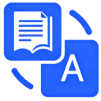
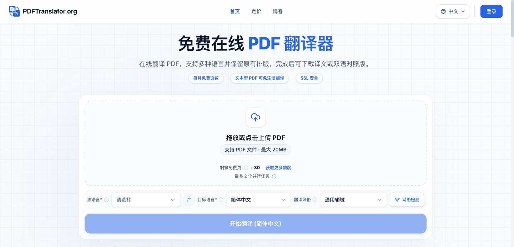
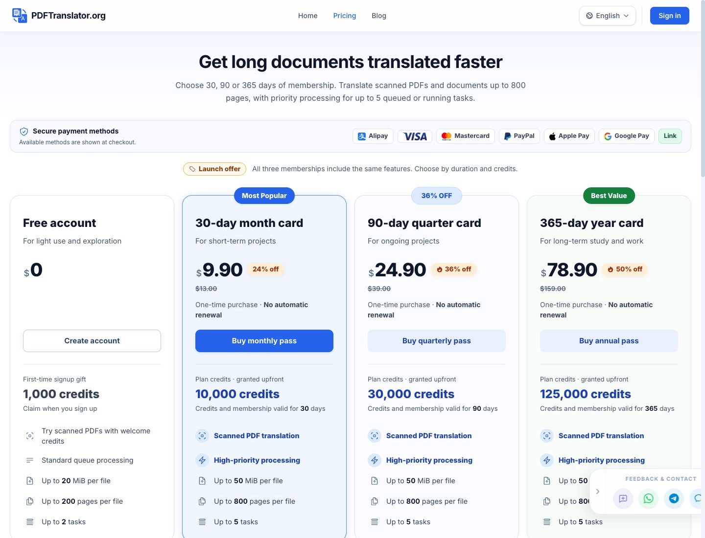
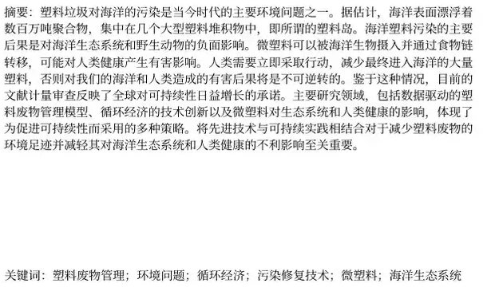

[English](README.md) · [简体中文](README.zh-CN.md) · [Español](README.es.md) · [Português (Brasil)](README.pt-BR.md)

# PDFTranslator.org — 免费在线 PDF 翻译器，AI 驱动保留排版

[PDFTranslator.org](https://pdftranslator.org/zh) 支持将整份 PDF 翻译为 100 多种语言，并尽可能保留文字布局、表格和图片。阅读译文可下载纯译文 PDF，需要对照时可下载原文与译文左右并排的双语 PDF。

**游客每自然月可免费翻译 30 页普通 PDF。注册账户每月有 100 页普通 PDF 免费额度，首次注册另赠 1,000 积分。需要 OCR 的扫描件按整份文件使用积分。**

[开始在线翻译 PDF](https://pdftranslator.org/zh) · [额度与价格](https://pdftranslator.org/zh/pricing) · [产品反馈与功能建议](https://pdftranslator-org.feedlog.ai/)

这是由 [SaaSAIHub](https://github.com/SaaSAIHub) 维护的官方产品文档仓库，提供在线服务的使用指南与翻译效果展示，不包含网站应用源码或翻译引擎。

*官网简体中文首页的游客视图。*

## 免费 AI PDF 翻译：功能与使用范围

PDFTranslator 适合学生、研究人员及职场用户阅读外语 PDF，减少逐段复制、粘贴翻译的工作。

| 功能 | 当前说明 |
| --- | --- |
| PDF 下载 | 纯译文 PDF、原文与译文左右并排的双语 PDF。 |
| 100 多种语言 | 自行选择文档源语言和目标语言。 |
| 保留排版 | 尽可能保留布局、表格、图片及页面结构；复杂文档需检查。 |
| 翻译风格 | 通用领域、学术论文、法律法规、商务文件；部分语言不支持风格设置。 |

| 使用身份 | 每月普通 PDF 免费页数 | 单文件上限 | 排队与处理中的任务数合计 |
| --- | ---: | --- | ---: |
| 游客 | 30 | 20 MiB / 200 页 | 2 |
| 免费账户 | 100 | 20 MiB / 200 页 | 2 |
| 有效会员 | 100 | 50 MiB / 800 页 | 5 |

会员卡提供 **30／90／365 天**三档，一次性购买，付款成功后开始计算期限，积分一次性发放。有效期内提高文件和并行任务上限，新任务优先处理；不会增加每月免费页，也不会自动续费。新购会员卡不延长旧积分期限，任务上限不叠加。详见[当前价格与权益](https://pdftranslator.org/zh/pricing)。首次注册赠送的 1,000 积分在下个月的对应日期到期；无对应日期时为该月最后一天。

*官网当前会员方案（英文界面），价格与可售状态以页面实时展示为准。*

## PDF 翻译工具对比：Google 翻译、DeepL 等

从排版、扫描 PDF 和双语下载，对比 PDFTranslator.org、Online DocTranslator、iLovePDF 与 Smallpdf。

| 功能 | **PDFTranslator.org** 推荐使用 | [Google 翻译](https://support.google.com/translate/answer/2534559?hl=en) | [DeepL](https://support.deepl.com/hc/en-us/articles/4411308018450-Translate-PDF-files) | [Online DocTranslator](https://www.onlinedoctranslator.com/en/translate-english-to-slovak_en_sk) | [iLovePDF](https://www.ilovepdf.com/blog/introducing-translate-pdf-ai-pdf-translation) | [Smallpdf](https://smallpdf.com/translate-pdf) |
| --- | --- | --- | --- | --- | --- | --- |
| **双语并排 PDF 下载** 原文与译文左右对照 | ✅ **支持** 单语与双语 PDF 均可下载 | ❌ **未提供** | ❌ **未提供** | ❌ **未提供** | ❌ **未提供** | ❌ **未提供** 仅网页对照 |
| **可选翻译风格** 按文档用途选择 | ✅ **4 种预设** 通用、学术、法律、商务 | ℹ️ **未见选项** | ⚠️ **语气可选** Pro，限部分语言 | ℹ️ **未见选项** | ℹ️ **未见选项** | ℹ️ **未见选项** |
| **排版保留** 译后版式与图片 | ✅ **保留排版** 原有 PDF 布局 | ⚠️ **复杂版式会错乱** | ⚠️ **保留格式** 免费结果有水印 | ⚠️ **复杂版式会错乱** | ⚠️ **复杂版式会错乱** | ⚠️ **复杂版式会错乱** |
| **OCR 支持** 扫描 PDF 翻译 | ✅ **支持** 需登录并使用积分 | ❌ **不支持** 不翻译扫描 PDF 中的文字 | ✅ **支持** 效果取决于扫描质量 | ⚠️ **需外部 OCR** 先转换为 Word | ✅ **支持** 内置 OCR | ✅ **支持** 内置 OCR |
| **文件大小限制** 免费与付费限制不同 | ✅ **20 MiB／200 页** 会员：50 MiB／800 页 | **10 MB／300 页** | **5 MB** 免费账户 | **未确认** 所查官方页面未说明 | **免费 15 MB** Premium：200 MB | **未确认** 所查官方页面未说明 |
| **免费使用额度** 额度与计费方式 | **每月免费页** 游客 30 页；账户 100 页；首次注册另赠 1000 免费积分 | **免费** 文档翻译 | **账户免费额度** 以账号显示为准 | **免费** 文档翻译 | **免费试用仅 1 次** 超额需付费，额度以工具为准 | **有限免费使用** 付费套餐不限量 |
| **账号要求** 开始使用的条件 | **无需注册** 文本型 PDF | **无登录步骤** 官方操作说明 | **需要账号** | **无需注册** | **依工具要求** 以当前页面为准 | **无需注册** |

核对日期：2026 年 11 月 25 日，依据官方资料与网页端实测。点击品牌可查看官方来源。

实测结论限于所用文档和账户条件，功能与限制依套餐而异。排版效果因文档而异。

本站免费页不含 OCR；部分语言不支持风格设置。

## 如何在线翻译 PDF

1. 打开 [PDFTranslator.org 中文首页](https://pdftranslator.org/zh)，选择或拖入 PDF。
2. 选择文档源语言和目标语言。
3. 选择通用领域，或按内容选择学术论文、法律法规、商务文件。
4. 点击“开始翻译”，在上传和文件检查期间保持页面打开。只用免费页且符合条件的任务会直接排队；需要积分时，先核对费用再确认提交。
5. 在首页“最近翻译”中查看进度。
6. 完成后可预览结果，也可下载纯译文 PDF 或双语 PDF。

保留原文件，及时下载译文。文件准备、任务限制及排错方法见[使用指南（英文）](docs/usage-guide.md)。

## PDF 翻译效果示例

以下页面对照均来自官网已发布的示例。前三组为论文、手册和教材的英译中页面，第四组为日文竖排文本的中文译页。

### 论文 PDF 翻译

对照阅读研究摘要，保留段落与关键词的上下文。

<table>
<tr><th>英文原文：摘要与关键词</th><th>中文译文：摘要与关键词</th></tr>
<tr><td width="50%"></td><td width="50%"></td></tr>
</table>

### 手册 PDF 翻译

阅读手册时，将章节标题、步骤编号和列表放在一起查看。

<table>
<tr><th>英文原文：员工手册</th><th>中文译文：员工手册</th></tr>
<tr><td width="50%"></td><td width="50%"></td></tr>
</table>

### 教材与课程资料 PDF 翻译

结合正文、列表和图示对照学习教材内容。

<table>
<tr><th>英文原文：教材</th><th>中文译文：教材</th></tr>
<tr><td width="50%"></td><td width="50%"></td></tr>
</table>

### 日文竖排 PDF 翻译

从右往左逐列对照，留意对话的起止位置、标点和阅读顺序。

<table>
<tr><th>日文竖排原文</th><th>中文竖排译文</th></tr>
<tr><td width="50%"></td><td width="50%"></td></tr>
</table>

术语、表格、图示及阅读顺序的检查方法见[翻译与排版检查指南（英文）](docs/translation-review.md)。

## 支持的语言与适用场景

官网提供英语、中文、日语、韩语、德语、法语、西语、越南语及巴西葡语九种界面。以下三个专用落地页目前**仅提供英文界面**；提交前可以更改源语言和目标语言，恢复的草稿保留原设置。

PDFTranslator.org 支持 100 多种翻译语言，包括英语、中文、西班牙语、法语、德语、葡萄牙语、日语和韩语。网站界面语言与文档翻译语言可分别选择。

| 翻译需求 | 选择方式 |
| --- | --- |
| [PDF 翻译成西班牙语](https://pdftranslator.org/translate/pdf-to-spanish) | 默认英语→西语，也可另选源语言。 |
| [德语 PDF 翻译成英语](https://pdftranslator.org/translate/german-to-english) | 默认德语→英语。 |
| [英语 PDF 翻译成泰米尔语](https://pdftranslator.org/translate/english-to-tamil) | 默认英语→泰米尔语。 |
| 英语 PDF 翻译成中文或葡萄牙语 | 源语言选择英语，选择对应的目标语言选项。 |

论文、研究报告和课程资料可选择“学术论文”；商务报告可选择“商务文件”；日常文档和手册可选择“通用领域”。涉及法律术语时可选“法律法规”，重要用途仍应复核措辞。

官网界面：[English](https://pdftranslator.org/) · [中文](https://pdftranslator.org/zh) · [Español](https://pdftranslator.org/es) · [Português (Brasil)](https://pdftranslator.org/pt-BR)。

## PDF 翻译常见问题

### PDFTranslator.org 免费且无需注册吗？

可以。游客每自然月可免费翻译 30 页普通 PDF。登录后先使用账户每月 100 页免费额度，超出部分每页 10 积分。未用完的免费页不结转。

### 翻译 PDF 能保留原格式吗？

工具尽可能保留布局、表格、图片和页面结构。译文长度可能变化，复杂表格、公式、字体与分页仍需检查，不保证完全一致。

### 可以翻译长篇 PDF 吗？

游客和免费账户每个文件最多 200 页、20 MiB；会员有效期内，每个文件最多 800 页、50 MiB。只需部分章节时可以拆分，按实际提交的页数使用额度。

### 扫描 PDF 可以直接翻译吗？

可直接上传扫描件。若检查提示需要 OCR，请登录并核对报价。按整份文件每页 20 积分计费，即使只有部分页面需要识别；普通免费页不能抵扣，注册赠送的积分可用。

### 翻译结果是 Word 文档吗？

主翻译流程输入 PDF，输出翻译后的 PDF。本仓库不将其描述为 PDF 转 Word 工具，也不承诺可编辑 DOCX 输出。

### 译文可以下载多久？

任务完成、失败或取消后，历史记录可见 24 小时。成功结果可自完成起预览和下载 24 小时，会员卡不会延长这一时限。请以任务卡显示的到期时间为准。

### PDF 文件只在本地处理吗？

翻译需要上传文件，由服务端处理。游客历史保存在当前浏览器，登录用户的历史由服务端按账户管理。访问到期后，存储副本和必要业务记录仍可能保留。详见[文件处理指南（英文）](docs/privacy.md)。

### 翻译失败或取消后，页数和积分怎么处理？

排队中的任务可以取消，进入处理后无法取消。任务失败或成功取消后，已使用的免费页和积分按规则返还，免费页返还到原月份。

### 这是可自行部署的开源翻译器吗？

不是。此仓库提供 PDFTranslator.org 在线服务的官方文档，不包含可自行部署的应用、翻译引擎或公共 API 软件包。

## 指南、PDF 工具与反馈

- [网页转 PDF](https://pdftranslator.org/zh/tools/web-to-pdf) · [Gmail 转 PDF](https://pdftranslator.org/zh/tools/gmail-to-pdf)
- [当前产品事实与核对来源（英文）](docs/current-product-facts.md)
- [PDF 翻译使用与排错指南（英文）](docs/usage-guide.md)
- [翻译质量与排版检查指南（英文）](docs/translation-review.md)
- [文件上传、保留期限与隐私（英文）](docs/privacy.md)
- [拆分 PDF](https://pdftranslator.org/zh/tools/split-pdf) · [合并 PDF](https://pdftranslator.org/zh/tools/merge-pdf) · [更多 PDF 工具](https://pdftranslator.org/zh/tools)
- [通过 FeedLog 提交问题与功能建议](https://pdftranslator-org.feedlog.ai/)
- [文档纠错与贡献方式（英文）](CONTRIBUTING.md)

公开反馈请使用无敏感内容的材料，不要上传私人文档、任务标识符或带签名的上传／下载链接。

**产品资料核对日期：2026 年 11 月 25 日。** 功能与限制可能变化，以[官网](https://pdftranslator.org/zh)、[隐私政策](https://pdftranslator.org/zh/privacy-policy)和[服务条款](https://pdftranslator.org/zh/terms-of-service)为准。
